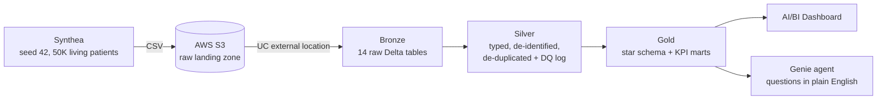

# Synthea Healthcare Lakehouse on Databricks

An end-to-end healthcare analytics platform built on **AWS S3 + Databricks (Unity Catalog, Delta Lake, serverless)** using the medallion architecture. 57,398 synthetic patients with full clinical and claims histories go from raw CSV files to a governed star schema, a population health dashboard and a conversational SQL agent.

The data is fully synthetic (generated with [Synthea](https://github.com/synthetichealth/synthea)), so the project uses realistic EHR and claims structures with no real patient information.

## Architecture



| Layer | Schema | What happens |
|---|---|---|
| Raw | `s3://.../synthea/raw/seed42_p50000/` | Synthea CSV export, kept as the immutable source |
| Bronze | `workspace.bronze` | One Delta table per CSV, original columns, plus `_source_file` and `_ingested_at` |
| Silver | `workspace.silver` | snake_case names, explicit types, PII removed, values standardised, duplicates removed, derived fields, 14 data quality checks logged to `dq_results` |
| Gold | `workspace.gold` | 5 dimensions, 3 facts, 8 KPI marts, primary/foreign keys and column comments |

## Dataset

| Item | Value |
|---|---|
| Generator | Synthea (master-branch-latest), Massachusetts, seed 42 |
| Patients | 57,398 (50,000 living, 7,398 deceased) |
| Files loaded | allergies, careplans, claims, conditions, devices, encounters, imaging_studies, immunizations, medications, organizations, patient_expenses, patients, payers, providers |
| Excluded | `claims_transactions.csv` (line-level billing, more than half the raw volume; claim-level cost is already in `claims` and `encounters`) |
| Raw size | about 7 GB of CSV (claims 2.4 GB, imaging_studies 2.1 GB, encounters 1.1 GB) |

Re-running Synthea with the same seed and settings reproduces the dataset exactly:

```bash
java -jar synthea-with-dependencies.jar -p 50000 -s 42 \
  --exporter.csv.export=true --exporter.fhir.export=false \
  --exporter.csv.excluded_files=claims_transactions.csv Massachusetts
```

## Silver layer design

- **Explicit casting.** `inferSchema` reads clinical codes as numbers and drops leading zeros from ZIP codes. Silver turns every code back into a string, restores 5-digit ZIP and FIPS codes and stores money as `decimal(18,2)`.
- **De-identification.** SSN, driver's licence, passport, names and street address stop at Bronze. Silver and Gold hold only a surrogate `patient_id` and coarse location.
- **Standardised values.** Gender, ethnicity and marital status codes become readable labels; empty strings become NULL.
- **Business keys and de-duplication** for every table.
- **Derived fields** used everywhere downstream: encounter duration, patient out-of-pocket cost, active flags, SNOMED condition type.
- **Data quality gate.** Key uniqueness, orphan records, negative costs and impossible dates are checked on every run and appended to `silver.dq_results`. Blocking failures stop the pipeline before Gold is rebuilt.

## Gold layer design

**Star schema** (for ad hoc analysis and the Genie agent)

| Table | Grain |
|---|---|
| `dim_patient` | patient (age, age band, income band, deceased flag) |
| `dim_provider`, `dim_organization`, `dim_payer` | provider, organization, payer (payer_type: Medicare, Medicaid, Dual eligible, Commercial, Uninsured) |
| `dim_date` | calendar day |
| `fact_encounter` | encounter, with cost split, length of stay and 30-day readmission flags |
| `fact_condition` | condition episode, mapped to 13 chronic disease groups |
| `fact_medication` | medication order with cost split |

**KPI marts** (for the dashboard): `kpi_overview`, `agg_monthly_utilization`, `agg_readmission_monthly`, `agg_payer_performance`, `agg_chronic_prevalence`, `agg_organization_performance`, `agg_top_medications`, `agg_patient_cost_yearly`.

**Key metric definitions**

| Metric | Definition |
|---|---|
| 30-day readmission rate | Inpatient admissions followed by another inpatient admission within 30 days of discharge, divided by all inpatient admissions whose 30-day window is complete |
| Length of stay | Inpatient stop minus start, in days |
| Payer coverage rate | Payer coverage divided by total claim cost |
| Chronic prevalence | Living patients ever diagnosed with the condition group, divided by living patients in the same gender and age band |
| Snapshot date | Latest encounter date in the data. Ages and "last 12 months" use this, not the real current date |

## Dashboard

A four-page Databricks AI/BI dashboard: executive overview, clinical quality, cost and payers, data quality. The dashboard is stored as code in [`dashboard/population_health_and_cost.lvdash.json`](dashboard/), generated by `dashboard/build_dashboard.py`. It is deployed by the bundle. The layout rationale is in [`dashboard/dashboard_plan.md`](dashboard/dashboard_plan.md).

## Conversational SQL agent

A Genie space over the Gold star schema answers questions such as *"Which payer type has the highest readmission rate?"* Setup, instructions and trusted example queries are in [`genie/genie_space_plan.md`](genie/genie_space_plan.md).

## Repository layout

```
notebooks/
  01_bronze_ingestion.py     S3 CSV -> bronze Delta tables
  02_silver_transform.py     cleaning, de-identification, DQ checks
  03_gold_model.sql          star schema, KPI marts, keys and comments
dashboard/                   AI/BI dashboard as code (.lvdash.json + generator) and layout plan
genie/genie_space_plan.md    Genie agent setup
tests/run_local.py           local PySpark smoke test of Silver and Gold
databricks.yml               Asset Bundle: variables and dev/prod targets
resources/                   bundle resources: medallion job, dashboard
.github/workflows/           CI/CD: checks, bundle validate, deploy to prod
```

## How to run

Everything (notebooks, the medallion job and the dashboard) is deployed as one **Databricks Asset Bundle**.

```bash
databricks auth login --host https://<your-workspace>.cloud.databricks.com
databricks bundle validate
databricks bundle deploy -t dev          # personal copy, "[dev <user>]" prefix
databricks bundle run medallion_pipeline -t dev
```

| Target | Used for |
|---|---|
| `dev` (default) | Development. Resources are prefixed with your name and schedules stay paused |
| `prod` | Deployed automatically by GitHub Actions on every push to `main` |

**CI/CD.** `.github/workflows/databricks-bundle.yml` runs on every pull request and push: it compiles the notebooks, checks the dashboard JSON matches its generator, validates the bundle and, on `main`, deploys to `prod`. It needs two repository secrets: `DATABRICKS_HOST` and `DATABRICKS_TOKEN`.

**Local smoke test** (no Databricks needed): see the instructions at the top of `tests/run_local.py`. It runs Silver and Gold end to end in local PySpark on a small Synthea sample.

## Tech stack

AWS S3, IAM, Databricks Free Edition (serverless compute, SQL warehouse), Unity Catalog, Delta Lake, PySpark, Spark SQL, Databricks Asset Bundles, GitHub Actions, AI/BI Dashboards, Genie.

## Author

Priyanka Andrew Charan
